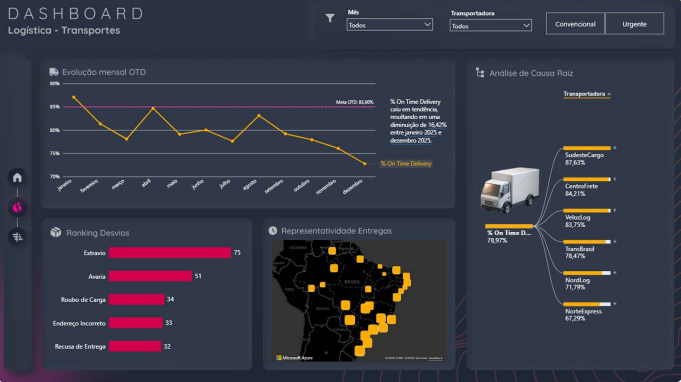

<h1 align="center">🚚 Dashboard de Logística · Transportes</h1>

<p align="center">
  Por que as entregas no prazo caíram ao longo de 2025,<br>
  e quais transportadoras, rotas e desvios precisam ser tratados para voltar à meta.
</p>

<p align="center">
  
  
  
</p>

## 📌 Sobre o projeto

Uma empresa despacha mercadorias para todo o Brasil com **seis transportadoras parceiras** e tem a meta de entregar **85% dos pedidos no prazo**. A base tem **1.755 entregas** feitas de janeiro a dezembro de 2025, com transportadora, tipo de frete, origem, destino, peso, valor da nota fiscal, frete, datas e desvios.

O projeto seguiu o caminho completo de uma análise:

1. **Briefing** com o contexto do negócio e as perguntas a responder ([`docs/briefing.md`](docs/briefing.md)).
2. **Tratamento da base** no Power Query.
3. **Modelagem e medidas** em DAX, com o cálculo do OTD.
4. **Dashboard em Power BI**, com filtros por mês, transportadora e tipo de frete.
5. **Análise** com insights e recomendações práticas.

Este repositório reúne o print do dashboard, o briefing e a explicação da análise.

> **Pergunta central:** por que o OTD caiu ao longo de 2025, e quais transportadoras, rotas e problemas precisam ser tratados para voltar a cumprir a meta de 85%?

## 📊 Dashboard



| Bloco | O que mostra |
|---|---|
| **Evolução mensal OTD** | Percentual de entregas no prazo mês a mês, comparado com a meta de 85% |
| **Ranking de desvios** | Quantidade de cada tipo de problema: extravio, avaria, roubo de carga, endereço incorreto e recusa de entrega |
| **Representatividade das entregas** | Mapa com a distribuição das entregas pelo Brasil |
| **Análise de causa raiz** | Árvore de decomposição que abre o OTD geral por transportadora |

**Filtros:** mês · transportadora · tipo de frete (convencional ou urgente).

## 🎯 Principais números

| Indicador | Resultado |
|---|---:|
| Entregas no ano | 1.755 |
| OTD geral | **78,97%** |
| Meta de OTD | 85% |
| Entregas atrasadas | 369 |
| Atraso médio das entregas atrasadas | 3,3 dias |
| Entregas com desvio | 225 (12,8%) |
| Valor em nota fiscal de cargas extraviadas ou roubadas | R$ 538 mil |
| Frete sobre o valor da nota fiscal | 3,3% |

## 🔍 Metodologia

1. **Limpeza:** a planilha original traz um título e uma linha de período antes do cabeçalho. Removi essas linhas no Power Query, promovi a linha de cabeçalho e defini os tipos de cada coluna: datas, números decimais e texto.
2. **Regra de OTD:** uma entrega está no prazo quando a data real de entrega é igual ou anterior à data prevista. O OTD é o percentual dessas entregas sobre o total.
3. **Atraso:** diferença em dias entre a data real e a data prevista, considerada só quando é positiva.
4. **Região de destino:** extraí a UF do campo de destino (por exemplo, "Crato/CE") e agrupei as UFs nas cinco regiões do país.
5. **Evolução mensal:** o OTD de cada mês considera o mês da data real de entrega.
6. **Causa raiz:** abri o OTD geral por transportadora, tipo de frete, prazo e região para encontrar o que mais explica a queda.

**Exemplo de medida em DAX:**

```dax
% On Time Delivery =
DIVIDE(
    COUNTROWS(
        FILTER(
            'Historico Transporte',
            'Historico Transporte'[Data_Entrega_Real] <= 'Historico Transporte'[Data_Prevista_Entrega]
        )
    ),
    COUNTROWS('Historico Transporte')
)
```

## 💡 Principais insights

### 1. O OTD fechou o ano 6 pontos abaixo da meta, e a queda se concentrou no fim do ano

O OTD geral foi de **78,97%**, contra a meta de 85%. Janeiro foi o único mês acima da meta (87,1%). Dezembro teve o pior resultado (72,8%), uma queda de **16,4%** em relação a janeiro.

A queda coincide com o pico de volume. Novembro e dezembro somaram 423 entregas, 24% do ano, e tiveram os dois piores OTDs (76,1% e 72,8%). O mesmo padrão aparece em todas as transportadoras, o que indica falta de capacidade na alta temporada.

### 2. Só uma transportadora cumpre a meta

| Transportadora | Entregas | OTD | Entregas com desvio | Frete médio |
|---|---:|---:|---:|---:|
| SudesteCargo | 299 | **87,6%** | 6,7% | R$ 151 |
| CentroFrete | 304 | 84,2% | 6,6% | R$ 154 |
| VelozLog | 283 | 83,7% | 11,0% | R$ 151 |
| TransBrasil | 288 | 78,5% | 14,6% | R$ 145 |
| NordLog | 312 | 71,8% | 16,0% | R$ 152 |
| NorteExpress | 269 | 67,3% | 23,0% | R$ 162 |

A diferença entre a melhor e a pior transportadora é de 20 pontos. A **NorteExpress** tem o pior OTD, o maior índice de desvios e o frete mais caro. A **NordLog** é a que mais entrega no ano (312 entregas) e fica 13 pontos abaixo da meta.

### 3. O problema está no frete convencional e nos prazos longos

O frete **urgente** entrega 93,8% no prazo. O **convencional**, que representa 75% das entregas, fica em 74,1%.

Entregas com prazo de até 3 dias têm OTD acima de 91%. A partir de 5 dias, o OTD cai para a faixa de 73% a 77%. O frete urgente custa em média R$ 232, 84% a mais que o convencional (R$ 126).

### 4. Norte e Nordeste puxam o resultado para baixo

| Região de destino | Entregas | OTD |
|---|---:|---:|
| Sudeste | 376 | 85,6% |
| Sul | 318 | 83,0% |
| Centro-Oeste | 377 | 82,8% |
| Nordeste | 392 | 73,2% |
| Norte | 292 | 68,8% |

O Sudeste é a única região que atinge a meta. Norte e Nordeste somam 39% das entregas e ficam entre 12 e 16 pontos abaixo dela.

### 5. Extravio é o desvio mais frequente, e o que mais custa

Das 1.755 entregas, **225 (12,8%)** tiveram algum desvio. O extravio lidera (75 casos), seguido por avaria (51), roubo de carga (34), endereço incorreto (33) e recusa de entrega (32).

Extravios e roubos somam **109 cargas e R$ 538 mil em notas fiscais**, 6,6% de todo o valor transportado no ano. Entregas com desvio também atrasam mais: o OTD delas é de 69,3%, contra 80,4% das entregas sem desvio.

### 6. Quando atrasa, atrasa muito

As 369 entregas atrasadas chegaram, em média, 3,3 dias depois do previsto. Uma em cada quatro atrasou 5 dias ou mais, e o maior atraso foi de 12 dias.

## 🚀 Recomendações

| Prioridade | Ação | Por quê |
|:---:|---|---|
| 1 | Redistribuir volume da NorteExpress e da NordLog para SudesteCargo e CentroFrete | As duas piores somam 581 entregas, com OTD entre 67% e 72% |
| 2 | Incluir no contrato um SLA de 85% de OTD, com multa por desvio | Hoje a diferença de desempenho não reflete no preço: a pior transportadora tem o frete mais caro |
| 3 | Planejar capacidade extra para novembro e dezembro | O pico de volume derrubou o OTD em todas as transportadoras |
| 4 | Revisar prazos e parceiros para Norte e Nordeste | As duas regiões ficam até 16 pontos abaixo da meta |
| 5 | Reforçar rastreamento e seguro de carga | Extravio e roubo somam R$ 538 mil em notas fiscais |
| 6 | Validar o endereço no momento do pedido | 33 desvios por endereço incorreto poderiam ser evitados antes do envio |

## 🔧 Próximas melhorias no dashboard

- **OTD por região:** trocar o mapa de volume por um mapa de OTD por estado, que mostra onde estão os atrasos.
- **Custo:** incluir cards de frete médio e frete sobre o valor da nota fiscal.
- **Valor em risco:** mostrar o valor das notas fiscais por tipo de desvio, além da quantidade.
- **Volume mensal:** colocar a quantidade de entregas junto da evolução do OTD, para deixar visível a relação com o pico de fim de ano.
- **Atraso em dias:** adicionar a distribuição dos atrasos, além do percentual no prazo.

## 🗂️ Base de dados

A planilha tem uma aba, **Historico Transporte**, com 1.755 entregas e 13 colunas.

| Campo | Descrição |
|---|---|
| `ID_Entrega` | Identificador da entrega |
| `ID_Transportadora` | Código da transportadora (TRP001 a TRP006) |
| `Tipo_Frete` | Convencional ou Urgente |
| `Origem`, `Destino` | Cidade e UF de saída e de entrega |
| `Peso_KG` | Peso da carga, em kg |
| `Valor_NF` | Valor da nota fiscal, em R$ |
| `Frete_R$` | Valor do frete, em R$ |
| `Data_Pedido` | Data do pedido |
| `Prazo_Dias` | Prazo de entrega combinado, em dias |
| `Data_Prevista_Entrega` | Data do pedido + prazo |
| `Data_Entrega_Real` | Data em que a entrega aconteceu |
| `Tipo_Desvio` | Problema na entrega, quando houve: extravio, avaria, roubo de carga, endereço incorreto ou recusa de entrega |

## 📁 Estrutura do repositório

```
dashboard-logistica-transportes/
├── docs/
│   └── briefing.md    # Contexto do negócio e perguntas a responder
├── images/
│   └── dashboard.png  # Print do dashboard
└── README.md          # Metodologia, insights e recomendações
```

## 🛠️ Ferramentas

- **Power BI** (Power Query, DAX e árvore de decomposição): dashboard e análise de causa raiz
- **Azure Maps**: mapa das entregas
- **Excel**: base original

## 👩‍💻 Autora

**Danielle Honório Stevam** · Analista de Dados Jr

[](https://www.linkedin.com/in/danielle-h-945320238/)
[](https://github.com/danielleh5)

📂 Veja também: [Análise de Vendas · Petshop](https://github.com/danielleh5/analise-vendas-petshop) · [Dashboard de Vendas Globais](https://github.com/danielleh5/dashboard-vendas-globais)
